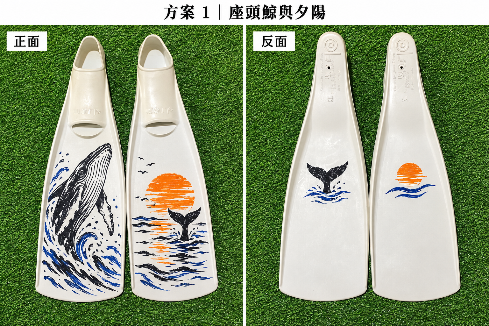
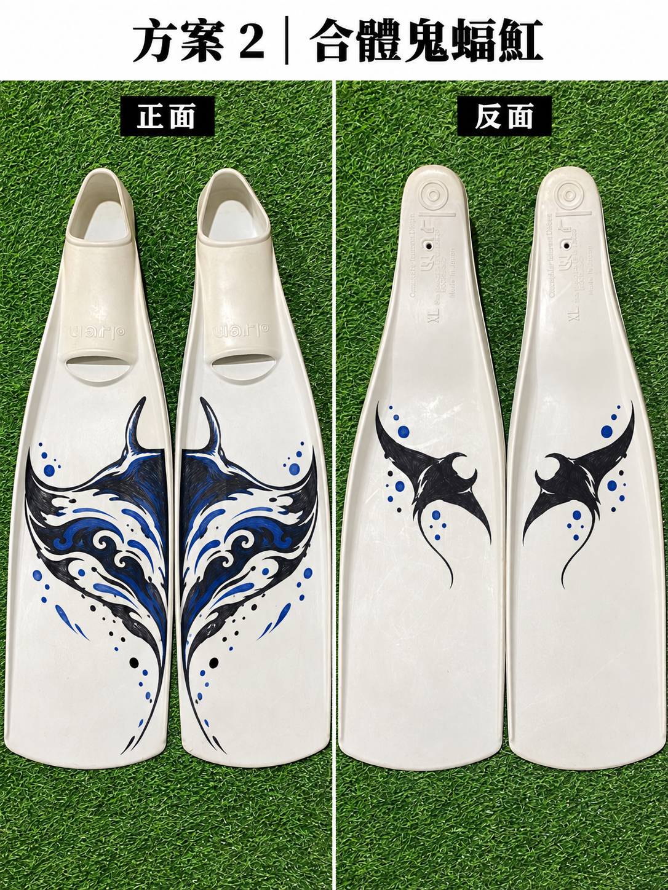
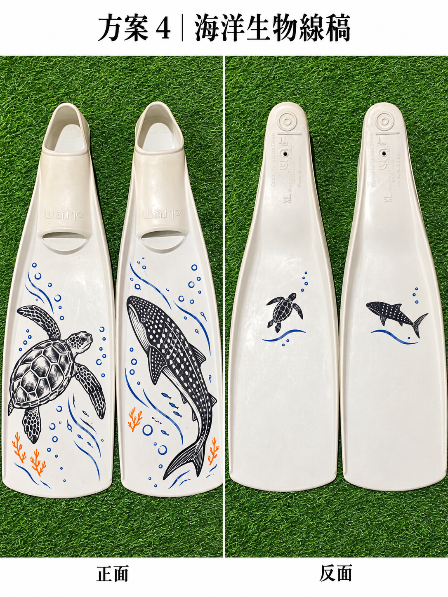

# 白色 GULL WARP M 蛙鞋彩繪建議指南

更新日期：2026-10-22  
適用裝備：白色 GULL WARP M 橡膠長蛙鞋

## 一、快速結論

如果希望做出接近日本蛙鞋藝術家 YURIE 的細緻作品，建議以 **uni（三菱鉛筆）PX-21 細字油漆筆**為主，較大色塊搭配 **PX-20 中字油漆筆**。

如果只想畫姓名、符號、粗線條或高辨識度色塊，可選擇 **SAKURA Solid Marker XSC 固態油漆筆**。它較粗、質感偏工業標記，不適合精細魚鱗或細小線稿。

白色蛙鞋推薦配色：

- 黑色＋橘色：對比最強，水面與船上容易辨識。
- 黑色＋藍色：海洋感明顯，耐看且容易搭配裝備。
- 黑色＋紅色：醒目，但大面積紅色可能顯得較重。
- 黑色單色線稿：最容易施工與補色，也較不容易變得雜亂。

## 二、日本蛙鞋藝術家 YURIE 使用的筆

YURIE 在自己的日文部落格中明確表示，她使用的是：

- 品牌：**三菱鉛筆（Mitsubishi Pencil／uni）**
- 系列：**PAINT MARKER／ペイントマーカー油性油漆筆**
- 用法：使用多種顏色並自行混色

參考資料：

- [YURIE 日文部落格：何を使って描いてるか。](https://ameblo.jp/narcissus326y/entry-12573467197.html)
- [台灣訪談：藝術，使我更能與海豚共游](https://www.idiver.com.tw/blog/posts/art-yurie)

她沒有在文章中公開完整型號，但依據「約14種顏色」、作品細節及產品線判斷，最可能使用 **PX-21 細字款**，也可能搭配 **PX-20 中字款**處理較大的區域。

### 關於訪談中的「與酒精混合」

台灣訪談寫成「與酒精混合讓它更加黏稠」，但加入酒精一般會降低黏度，這段可能有翻譯或轉述誤差。較合理的解讀是：

1. 將不同顏色的油漆筆顏料混合調色。
2. 以酒精清潔蛙鞋表面的油膜。

**不要直接拆開 PX-21 並把藥用酒精倒進墨水。** 這可能破壞顏料、樹脂與溶劑比例，也會增加揮發性溶劑的暴露風險。

## 三、推薦用筆與台灣購買連結

價格與庫存會變動，購買前請再次確認顏色及筆幅。

### A. 首選：uni PX-21 細字油漆筆

- 筆幅：約 0.8～1.2 mm
- 用途：線稿、魚鱗、眼睛、文字、姓名、圖案輪廓及細部上色
- 建議顏色：黑、藍、橘、紅
- 優點：容易在台灣購買，色彩選擇多，適合精細圖案
- 限制：並非專門為反覆彎曲的蛙鞋設計，必須先做附著與泡水測試

購買連結：

- [BDK 博帝克：uni PX-21 系列](https://www.bdk.com.tw/products/uni-mitsubishi-pencil-paint-pen-fine-characters-px-21-series)
- [1768 購物網：PX-21 細字油漆筆](https://www.1768.com.tw/OC3/index.php?product_id=3673&route=product%2Fproduct)
- [momo：uni PX-21 0.8～1.2 mm](https://www.momoshop.com.tw/product/13178832)
- [蝦皮：三菱 Uni-ball PX-21](https://shopee.tw/%E4%B8%89%E8%8F%B1Uni-ball-PAINT-MARKER-%E6%B2%B9%E6%BC%86%E7%AD%86-%E6%94%AF%28%E7%B4%B0%E5%AD%97%29PX-21-i.3949761.1455377985)

### B. 搭配使用：uni PX-20 中字油漆筆

- 筆幅：約 2.2～2.8 mm
- 用途：中等色塊、較粗輪廓、填滿 PX-21 不易處理的區域
- 建議方式：先用 PX-20 填色，再用 PX-21 修邊及增加細節
- 不建議拿來畫非常大的滿版底色；塗層越厚，彎曲後越容易裂開

購買時可搜尋：**uni PX-20 油漆筆 中字**。

### C. 粗線與辨識標記：SAKURA Solid Marker XSC

- 類型：固態油漆筆／工業標記筆
- 用途：姓名縮寫、粗線、幾何色塊、大型符號
- 優點：原廠資料列明可用於橡膠，乾後具防水及耐褪色特性
- 限制：筆畫很粗，表面可能帶有蠟狀或立體質感，不適合細緻插畫

購買連結：

- [iOPEN Mall：SAKURA XSC Solid Paint Marker](https://mall.iopenmall.tw/051558/index.php?action=product_detail&prod_no=P5155807814475)
- [永昌創新：SAKURA XSC 工業蠟筆](https://www.yc8899.com.tw/yc8899/index.php?action=product_detail&prod_no=P0122500230842)

原廠參考：

- [SAKURA Industrial Marking Tools](https://www.sakuraofamerica.com/wp-content/uploads/2020/08/Industrial-small.pdf)

### D. 不建議作為主要工具

- 一般酒精麥克筆：顏色通常不透明度不足，海水與摩擦耐久度有限。
- 一般奇異筆：可用於臨時簽名，但不適合希望長期保存的完整圖案。
- POSCA 水性筆：乾後有一定耐水性，但在橡膠反覆彎曲、摩擦與海水環境下，耐久度通常不如油性油漆筆。
- 一般壓克力顏料：沒有柔性底劑時，容易在葉片彎曲處龜裂。
- 汽車透明漆或硬質保護漆：可能因蛙鞋彎曲而裂開、大片剝落，不建議使用。

## 四、需要準備的材料

- 中性洗碗精
- 清水與乾淨軟布
- 無棉絮擦拭布
- 低黏度紙膠帶
- 紙張、鉛筆及描圖紙
- 美工刀與切割墊，用於製作模板；不要直接在蛙鞋上切割
- uni PX-21 細字油漆筆
- 視需要增加 PX-20 中字筆或 SAKURA Solid Marker
- 一次性手套
- 通風良好的陰涼工作區

選配：70% 異丙醇。只用於小範圍測試後的快速除油，不可浸泡蛙鞋，也不要把酒精加入油漆筆。

## 五、正式繪製步驟

### 步驟1：檢查並拍照留存

1. 確認蛙鞋沒有裂痕、掉色或製造瑕疵。
2. 先拍攝正反面與型號標示，以便保留新品狀況紀錄。
3. 若仍可能退換貨，建議先確認店家與原廠保固規定；自行彩繪通常可能影響退換或保固。

### 步驟2：清除表面油膜

1. 用溫水與少量中性洗碗精完整清洗葉片。
2. 以清水充分沖淨，不留下清潔劑。
3. 放在陰涼通風處自然乾燥至少24小時。
4. 觸摸時不要再次把護手霜或手部油脂沾到預定繪圖區。

若水滴仍明顯縮成珠狀、表面感覺油滑，可先在不起眼處測試少量70%異丙醇。確認橡膠沒有發黏、褪色或變白後，才用微濕布快速擦拭繪圖區，隨即讓它完全揮發。

禁止使用：丙酮、香蕉水、去漬油、煞車清潔劑、強力除膠劑或其他未知溶劑。

### 步驟3：進行小面積相容性測試

1. 在葉片內側或較不起眼處畫一條約1公分的線。
2. 放置48～72小時。
3. 將葉片彎曲約20次。
4. 泡清水數小時，再以濕布輕擦。
5. 檢查是否發黏、溶出、龜裂或整片剝離。

通過測試後再正式繪製。測試失敗時應更換筆，不要用硬質透明漆強行封住。

### 步驟4：選擇圖案位置

較適合的位置：

- 腳套前方至葉片中段的平坦區域
- 左右外側、不會直接磨地的位置
- 從水面或船上容易看到的上表面

應避開的位置：

- 腳套與腳背會頻繁伸縮的區域
- 排水孔
- 側邊肋條
- 葉片彎折最劇烈的溝槽
- 底部容易接觸地面或船板的區域
- 尺寸、型號及重要原廠標示

圖案最好距離葉片邊緣至少1～2公分，總面積控制在每支葉片約四分之一以內。

### 步驟5：先在紙上完成設計

1. 描出左右蛙鞋的大致輪廓。
2. 確認左右圖案方向，避免穿上後顛倒。
3. 將複雜圖案簡化成粗輪廓與較大的封閉色塊。
4. 預先決定上色順序：淺色、主色、深色輪廓、最後細節。
5. 需要對稱時，利用描圖紙將同一模板翻面轉印。

### 步驟6：固定模板

1. 使用低黏度紙膠帶固定紙模板或鏤空模板。
2. 不要把強黏性膠帶長時間貼在橡膠上。
3. 使用美工刀切模板時，必須在切割墊上完成，絕對不要直接在蛙鞋表面切割。

### 步驟7：薄層上色

1. 戴上手套並保持通風。
2. 依產品說明搖勻油漆筆並在廢紙上壓出墨水。
3. 先用 PX-21 描出輪廓或定位點。
4. 使用 PX-20 或 PX-21 填色，每層保持薄而均勻。
5. 等前一層表面乾燥後再疊下一層。
6. 最後以黑色 PX-21 修整輪廓及加入細節。

不要為了完全遮蓋而一次堆積厚漆。蛙鞋彎曲時，厚塗層比薄塗層更容易龜裂和脫落。

### 步驟8：充分乾燥

1. 平放在陰涼、無灰塵且通風的地方。
2. 建議至少靜置48～72小時後再泡水。
3. 不要曝曬、烘烤或用吹風機加熱。
4. 乾燥期間不要把兩支蛙鞋疊在一起。

### 步驟9：下水前測試

1. 先泡清水數小時。
2. 彎曲葉片並用濕布輕擦圖案。
3. 檢查水中是否出現明顯顏料碎片或掉色。
4. 通過後先進行一次泳池或平靜水域短時間測試，再投入正式潛水。

### 步驟10：日常保養

1. 每次潛水後立即用大量淡水沖洗。
2. 不要用刷子或菜瓜布摩擦圖案。
3. 避免長時間曝曬及高溫車廂。
4. 收納時不要讓尖硬裝備壓住彩繪區。
5. 小範圍磨損時，清潔、乾燥後再局部補色。

## 六、白色 WARP M 圖樣建議

### 方案1：座頭鯨與夕陽

- 左腳：黑色座頭鯨線稿
- 右腳：橘色圓日與少量海浪
- 兩腳末端加入姓名縮寫
- 優點：黑橘對比強、容易辨識、適合白底

### 方案2：左右合體鬼蝠魟

- 每支蛙鞋各畫一半翅膀
- 兩腳併攏時形成完整鬼蝠魟
- 黑色輪廓配藍色內部線條
- 注意：左右模板必須鏡像處理

### 方案3：太陽與月亮

- 左腳：橘紅色太陽
- 右腳：深藍月亮
- 搭配黑色星點或浪紋
- 優點：施工簡單，遠距離辨識度高

### 方案4：海洋生物線稿

- 題材可選海龜、海豚、鯨鯊、裸鰓類或章魚
- 以黑色線稿為主，只在局部加入一至兩種顏色
- 優點：補色容易，局部磨損也不會太明顯

### 方案5：純辨識設計

- 每支畫大型姓名縮寫
- 加上不同方向的黑色與橘色斜紋
- 左右腳可標示 L／R
- 優點：最耐看、最好施工，也最方便在船上辨認

## 七、建議的第一組採購清單

白色蛙鞋本身就是底色，不需要另外購買白筆。三個候選方案的基本顏色如下：

| 方案 | 必買顏色 | 建議筆款 | 主要用途 |
| --- | --- | --- | --- |
| 方案1：座頭鯨與夕陽 | 黑、藍、橘 | PX-21三色；可加PX-20橘 | 黑色鯨魚與輪廓、藍色海浪、橘色夕陽 |
| 方案2：合體鬼蝠魟 | 黑、藍 | PX-21黑／藍；可加PX-20黑 | 黑色輪廓與較大色塊、藍色內部浪紋 |
| 方案4：海洋生物線稿 | 黑、藍、橘 | PX-21三色 | 黑色海龜與鯨鯊、藍色水流、橘色珊瑚點綴 |

### 方案1採購建議

1. uni PX-21黑色一支
2. uni PX-21藍色一支
3. uni PX-21橘色一支
4. uni PX-20橘色一支，可選購；用於快速填滿夕陽色塊

### 方案2採購建議

1. uni PX-21黑色一支；用於輪廓及修邊
2. uni PX-21藍色一支；用於浪紋與氣泡
3. uni PX-20黑色一支；主圖保留大量白色負空間時通常足夠

不要把鬼蝠魟整片完全塗黑。保留白色區域可以降低墨水用量，也比較不容易在橡膠彎曲後出現大片裂紋。

### 方案4採購建議

1. uni PX-21黑色一支
2. uni PX-21藍色一支
3. uni PX-21橘色一支

方案4主要是線稿，通常不需要PX-20中字筆。

### 尚未決定方案時的最小購買組合

1. uni PX-21黑色一支
2. uni PX-21藍色一支
3. uni PX-21橘色一支
4. 若最後選方案2，再增加uni PX-20黑色一支
5. 低黏度紙膠帶
6. 中性洗碗精與無棉絮擦拭布

先完成小面積附著與泡水測試，再依最終圖案大小補買。先前提到「PX-21黑色兩支」只是針對大量黑色填滿的保守備用量；方案1與方案4以線稿方式繪製時，第一次購買一支通常足夠。

## 八、安全與耐久提醒

- 油漆筆含揮發性溶劑，務必保持通風並遠離火源。
- 不要在密閉房間長時間大量使用。
- 不要任意混合不同溶劑、油漆或透明漆。
- 不要把彩繪延伸至腳套內側，以免顏料長時間接觸皮膚。
- 任何附著在橡膠上的顏料都可能隨彎曲、摩擦與海水使用逐漸磨損；沒有真正永久不掉的做法。
- 圖案小而清楚，比滿版厚塗更耐用，也能減少塗料碎片進入水中。

## 九、方案1、2、4實際示意圖

以下新版示意圖直接以實物 GULL WARP 正、反面照片為基礎：正面配置主要作品；反面只使用較小、線條較粗的辨識符號，避開圓形腳跟落地區、排水孔、浮雕文字、刮痕明顯區與葉片末端高磨耗區。

### 方案1：座頭鯨與夕陽

### 方案2：合體鬼蝠魟

### 方案4：海洋生物線稿

## 十、完工後是否噴透明保護層

### 建議結論

完成後不要另外噴一般透明保護漆。GULL WARP 是會大幅彎曲的橡膠蛙鞋；一般壓克力透明漆、汽車金油、模型透明漆或其他硬質塗膜，可能在反覆彎曲、踩踏、海水與日曬後龜裂或大片剝落。部分溶劑也可能造成橡膠變色、發黏或提早老化。

### 建議完工方式

1. 所有顏色採薄層繪製，避免堆積厚漆。
2. 每層乾燥後再疊色。
3. 完成後置於陰涼通風處至少72小時；保守做法是等待5～7天再下水。
4. 先泡清水數小時，再彎曲葉片並以濕布輕擦測試。
5. 每次使用後以大量淡水沖洗並陰乾。
6. 磨損時清潔、乾燥後，以原本的油漆筆局部補色。

### 不建議使用

- 汽車金油或2K透明漆
- 一般壓克力透明噴漆
- 模型透明漆
- 指甲油
- 環氧樹脂
- 瞬間膠
- 透明矽利康

如果一定要測試保護層，只能選擇明確標示適用於天然橡膠、可反覆彎曲且可長期浸水的柔性透明塗料，並先在不起眼處做小範圍相容性測試。即使產品標示為柔性，也不建議直接噴滿整支蛙鞋。PX-21／PX-20充分乾燥後直接使用、日後局部補色，仍是目前風險最低且最好維護的方案。
